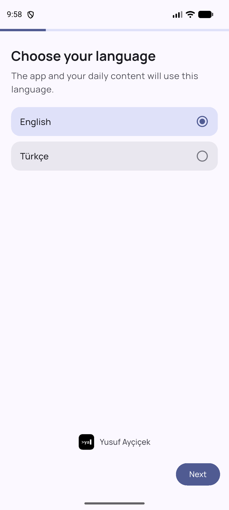
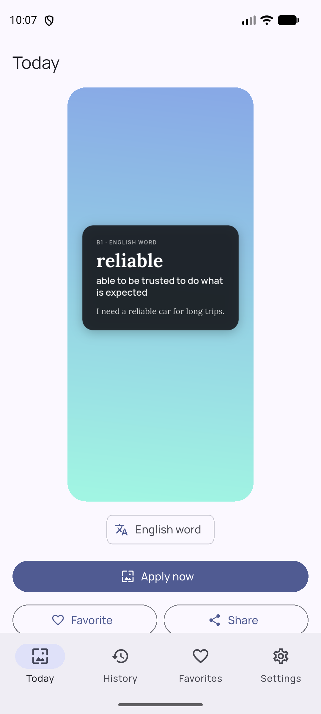
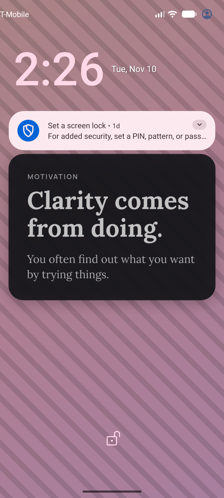
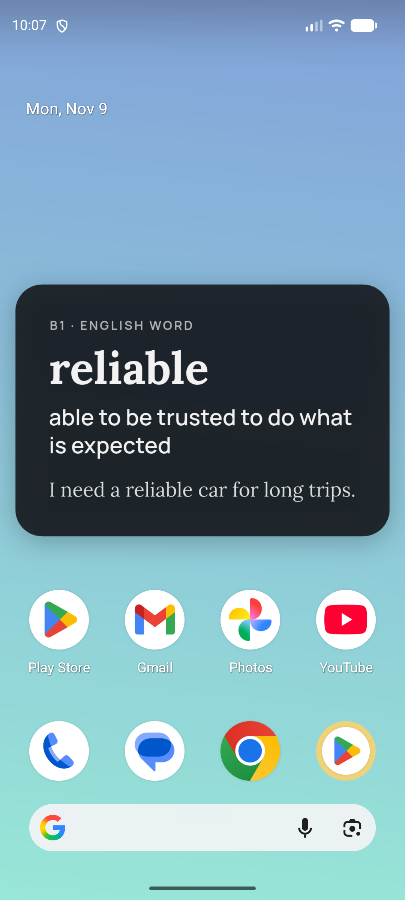
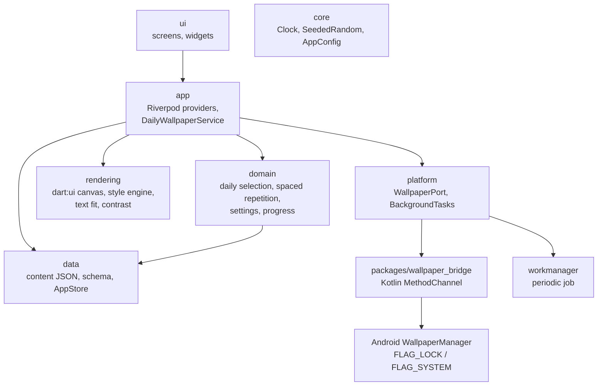

# dailywall

[](https://github.com/yusuf-aycicek/dailywall/actions/workflows/ci.yml)

*[Türkçe](README.tr.md)*

dailywall is an Android app that gives you a new wallpaper every day, made from your
interests: an English word for your level, a software tip, a motivational line or a
piece of general knowledge. Each wallpaper is drawn on the phone itself. The app has
no internet permission, no account, no ads and no analytics.

- **Daily, offline:** a background job sets the day's wallpaper on the lock screen,
  the home screen or both. If today's wallpaper is already set, the job exits at once.
- **Learns with you:** mark an English word "I know it" and it stops coming back. Mark
  it "Show again" and it comes back after 2, 5 and 10 days.
- **No repeats:** each category goes through all its items before any of them repeats.
  Categories take turns day by day.
- **Readable:** text stays clear of the lock-screen clock and the home-screen
  shortcuts. It shrinks to fit and always meets a WCAG contrast ratio of 4.5:1.
- **Style engine:** 50 styles in 10 families (dictionary page, terminal, calendar
  page, wall calendar, risograph, topographic, halftone, Bauhaus, waves, notebook).
  Pick families and let it surprise you every day, or pin one style. Backgrounds are
  drawn in code from the date and the category, so the same day always looks the
  same. See every style in the [catalog](docs/design/catalog/README.md).
- **Turkish and English**, Material 3, light and dark theme, large system fonts.

## Screenshots

Screenshots go in [`docs/screenshots/`](docs/screenshots/). To take them, see
[docs/guides.tr.md](docs/guides.tr.md#5-readme-ekran-görüntüleri).

| Onboarding | Today | Lock screen | Home screen |
|---|---|---|---|
|  |  |  |  |

## Architecture

The code has five layers, and each layer depends only on the layers below it.
`lib/app` connects them.



| Layer | Folder | What it does |
|---|---|---|
| core | `lib/core` | An injectable `Clock`, a seeded random generator, and app constants such as names and links |
| data | `lib/data` | Content models, JSON schema checks, the loader, and local storage (`shared_preferences`) |
| domain | `lib/domain` | Picks the day's item deterministically, handles spaced repetition, and holds the settings and progress models |
| rendering | `lib/rendering` | Draws the wallpaper with `PictureRecorder`/`Canvas` at the screen's physical resolution. It works in the background isolate too |
| platform | `lib/platform`, `packages/wallpaper_bridge` | Sets the wallpaper and schedules the daily job. This is the only Android-specific code |
| app | `lib/app` | `DailyWallpaperService` (one entry point for the app and the background job) and the providers |
| ui | `lib/ui` | Screens: onboarding, today, history, favorites, settings, about |

Some design choices:

- **The wallpaper channel is a local plugin**, not code in `MainActivity`. WorkManager
  starts its own Flutter engine for the background job. Plugins are registered on that
  engine too, while code in `MainActivity` would not be.
- **The same service runs on open and in the background.** `ensureToday()` is
  idempotent. When the app opens it applies the wallpaper if the background job has
  not run yet, and both paths share one "already applied" key.
- **Selection is deterministic.** The order inside a category comes from a seed built
  from (category, cycle). The same day always gives the same item, and there are no
  repeats until the category is used up.

## Tech stack

Flutter (stable), Dart, Riverpod, shared_preferences, workmanager, share_plus,
flutter_localizations with ARB files, Kotlin for the wallpaper bridge. Fonts
(Instrument Serif, Literata, Barlow Condensed, Bricolage Grotesque, IBM Plex Sans and
Mono, Space Grotesk, Fraunces, Manrope, Lora, JetBrains Mono, Anton, and Gentium Book
Plus for phonetic symbols; SIL Open Font License) are bundled in `assets/fonts`. minSdk 24.

## Setup and run

Requirements: Flutter stable, the Android SDK, and an emulator or a phone.

```bash
flutter pub get
flutter run
```

On Windows, keep the project, `PUB_CACHE` and `GRADLE_USER_HOME` on paths that are
ASCII only with no spaces (for example `C:\dev\...`). If your user folder has non-ASCII
characters, also set `TEMP`/`TMP` to such a folder before building. Otherwise Gradle
and the JDK fail with "Unable to establish loopback connection".

Change the package name in **one place**: `android/gradle.properties`
(`dailywall.applicationId`, `dailywall.appLabel`).

### Tests

```bash
flutter analyze
dart run tools/validate_content.dart   # content report, exits 1 on errors
flutter test --exclude-tags golden     # what CI runs
```

CI also runs the size, safe-area and contrast tests (`test/rendering/rendering_test.dart`).

**Golden tests** (`test/rendering/golden_test.dart`, tagged `golden`) compare
every style recipe against `docs/design/catalog/<recipe name>.png` (the style
catalog) and the share watermark against `test/rendering/goldens/`. Font rasterization differs
between operating systems, so CI does not run them. Run them locally:

```bash
flutter test --tags golden                    # compare
flutter test --tags golden --update-goldens   # regenerate after an intended change
```

After updating, look at the changed PNGs in `docs/design/catalog/` and
`test/rendering/goldens/` before you commit them.

### Adding a style

A style is one line in `assets/styles/recipes.json`: a background, a layout, a palette
and a font pair (all by id), the family, and `premium`. Run
`flutter test test/rendering`: invalid recipes (an unknown part, text contrast below
4.5:1, a font that is not bundled) fail `style_book_test.dart`, and
`rendering_test.dart` checks every recipe at three screen sizes with long and short
texts. Then regenerate the catalog with `--update-goldens` and the one-per-family
overview with `python tools/design/overview.py`.

### Testing the daily change without waiting

In a debug build, **Settings → Developer** can run the background job now, pretend it
is tomorrow, and show the background log. To trigger the real WorkManager job from a
terminal, see [docs/guides.tr.md](docs/guides.tr.md#3-arka-plan-görevini-beklemeden-test-etmek).

## Adding content

Content lives in `assets/content/<category>.json`, one file per category:

```json
{
  "category": "software_tips",
  "kind": "text",
  "items": [
    { "id": "sw_0031",
      "text":   { "en": "Short tip.",      "tr": "Kısa ipucu." },
      "detail": { "en": "One more line.",  "tr": "Bir satır daha." } }
  ]
}
```

English words use `"kind": "word"` with `level` (A1–C1), `word`, `meaning` and
`example`. Every text needs every app language. Ids are `<prefix>_<4 digits>` and must
be unique. Length limits are in `lib/data/content_schema.dart`. After editing, run
`dart run tools/validate_content.dart`. The tests run the same checks.

- **New item:** add it to the JSON file and run the validator.
- **New category:** add a JSON file, an entry in `ContentCatalog.categories`
  (`lib/data/content_models.dart`), its label and description in the ARB files, and
  their cases in `categoryLabel` / `Labels.categoryDescription` / `categoryIcon`.
- **New language:** add `lib/l10n/app_<code>.arb` (including `languageNativeName`),
  run `flutter gen-l10n`, and add the `<code>` text to every content item. The
  validator lists every missing one.

## Privacy

dailywall collects nothing and has no network access. See the
[privacy policy](docs/privacy-policy.md).

## License and credits

Code © Yusuf Ayçiçek. The fonts are under the SIL Open Font License. Their licenses
are shown in the app under About → Licenses.
