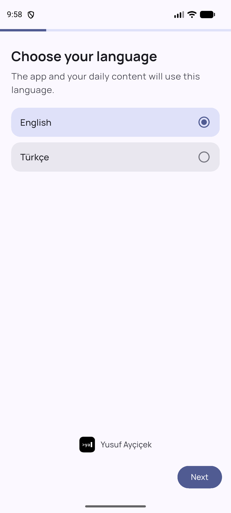
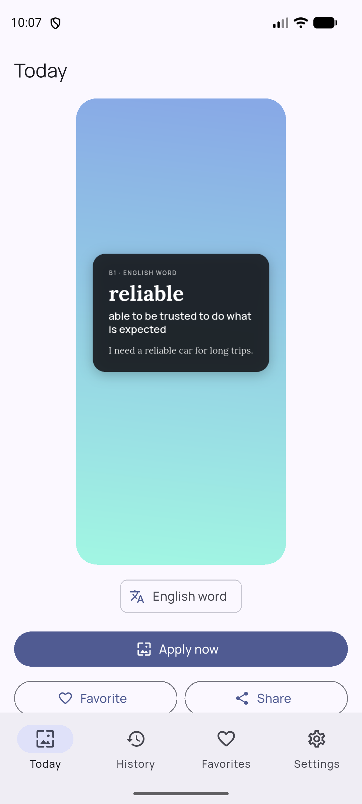
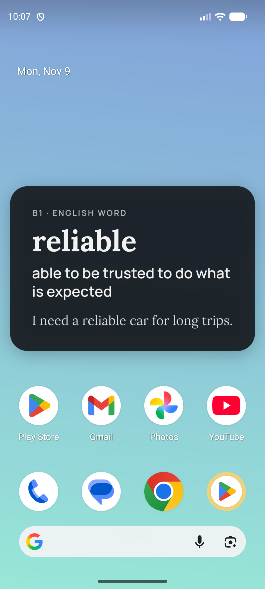
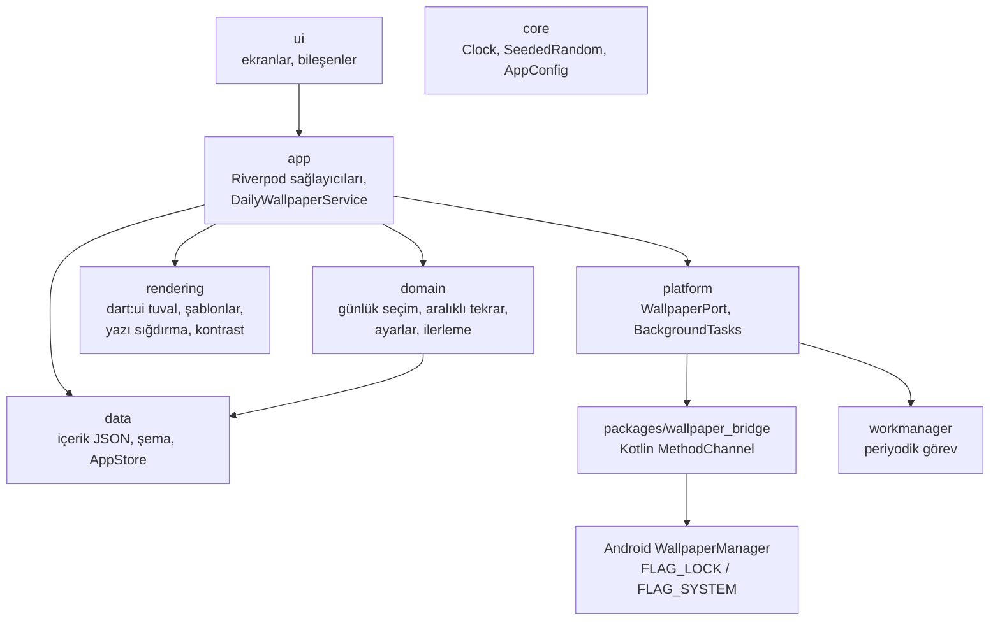

# dailywall

[](https://github.com/yusuf-aycicek/dailywall/actions/workflows/ci.yml)

*[English](README.md)*

dailywall, ilgi alanlarına göre her gün yeni bir duvar kâğıdı veren bir Android
uygulamasıdır. Duvar kâğıdında seviyene uygun bir İngilizce kelime, bir yazılım
ipucu, bir motivasyon cümlesi ya da bir genel kültür bilgisi olur. Her duvar kâğıdı
telefonun kendisinde çizilir. Uygulamanın internet izni, hesabı, reklamı ve analitiği
yoktur.

- **Her gün, çevrimdışı:** arka plan görevi günün duvar kâğıdını kilit ekranına, ana
  ekrana ya da ikisine birden koyar. Bugünün duvar kâğıdı zaten konmuşsa görev hemen
  çıkar.
- **Seninle öğrenir:** bir kelimeye "Biliyorum" dersen bir daha gelmez. "Tekrar göster"
  dersen 2, 5 ve 10 gün sonra yeniden gelir.
- **Tekrar yok:** bir kategorinin bütün içerikleri gösterilmeden hiçbiri tekrar etmez.
  Kategoriler günden güne sırayla gelir.
- **Okunaklı:** yazı, kilit ekranındaki saatin ve ana ekrandaki kısayolların üstüne
  gelmez. Sığmazsa küçülür, kontrast oranı her zaman en az 4,5:1'dir (WCAG).
- **Üç stil:** minimal, kart ve kalın yazı. Arka plan tarihten ve kategoriden üretilir.
- **Türkçe ve İngilizce**, Material 3, açık ve koyu tema, büyük sistem yazı boyutu.

## Ekran görüntüleri

Ekran görüntüleri [`docs/screenshots/`](docs/screenshots/) klasörüne konur. Nasıl
alınacağı için [docs/guides.tr.md](docs/guides.tr.md#5-readme-ekran-görüntüleri)
dosyasına bakın.

| Karşılama | Bugün | Ana ekran |
|---|---|---|
|  |  |  |

## Mimari

Kod beş katmandan oluşur. Her katman yalnızca altındaki katmanlara bağlıdır, onları
`lib/app` birbirine bağlar.



| Katman | Klasör | Görevi |
|---|---|---|
| core | `lib/core` | Dışarıdan verilebilen `Clock`, tohumlu rastgele sayı üreteci, uygulama sabitleri (adlar, bağlantılar) |
| data | `lib/data` | İçerik modelleri, JSON şema denetimi, yükleyici, yerel depolama (`shared_preferences`) |
| domain | `lib/domain` | Günün içeriğini her seferinde aynı sonucu verecek şekilde seçer, aralıklı tekrarı yönetir; ayar ve ilerleme modelleri buradadır |
| rendering | `lib/rendering` | Duvar kâğıdını `PictureRecorder`/`Canvas` ile ekranın fiziksel çözünürlüğünde çizer. Arka plan isolate'inde de çalışır |
| platform | `lib/platform`, `packages/wallpaper_bridge` | Duvar kâğıdını koyar, günlük görevi zamanlar. Android'e özgü kod yalnızca buradadır |
| app | `lib/app` | `DailyWallpaperService` (uygulama ve arka plan görevi için tek giriş noktası) ve sağlayıcılar |
| ui | `lib/ui` | Ekranlar: karşılama, bugün, geçmiş, favoriler, ayarlar, hakkında |

Bazı tasarım kararları:

- **Duvar kâğıdı kanalı `MainActivity` içinde değil, yerel bir eklentidedir.**
  WorkManager arka plan görevi için ayrı bir Flutter motoru başlatır. Eklentiler o
  motora da kaydedilir, `MainActivity`'deki kod kaydedilmezdi.
- **Açılışta ve arka planda aynı servis çalışır.** `ensureToday()` kaç kez çağrılırsa
  çağrılsın aynı sonucu verir. Arka plan görevi henüz çalışmadıysa uygulama açılınca
  duvar kâğıdını koyar. İki yol aynı "zaten kondu" anahtarını kullanır.
- **Seçim her seferinde aynı sonucu verir.** Kategorinin içindeki sıra (kategori, tur)
  ikilisinden üretilen tohumla belirlenir. Aynı gün hep aynı içerik çıkar, kategori
  bitmeden tekrar olmaz.

## Teknoloji

Flutter (stable), Dart, Riverpod, shared_preferences, workmanager, share_plus,
flutter_localizations ve ARB dosyaları, duvar kâğıdı köprüsü için Kotlin. Yazı tipleri
(Manrope, Lora, JetBrains Mono, Anton; SIL Open Font License) `assets/fonts` içinde
uygulamayla birlikte gelir. minSdk 24.

## Kurulum ve çalıştırma

Gerekenler: Flutter stable, Android SDK, bir emülatör ya da telefon.

```bash
flutter pub get
flutter run
```

Windows'ta projeyi, `PUB_CACHE`'i ve `GRADLE_USER_HOME`'u yalnızca ASCII karakterli ve
boşluksuz yollarda tutun (ör. `C:\dev\...`). Kullanıcı klasörünüzün adında Türkçe
karakter varsa derlemeden önce `TEMP`/`TMP`'yi de böyle bir klasöre yönlendirin. Yoksa
Gradle ve JDK "Unable to establish loopback connection" hatası verir.

Paket adı **tek yerden** değişir: `android/gradle.properties`
(`dailywall.applicationId`, `dailywall.appLabel`).

### Testler

```bash
flutter analyze
dart run tools/validate_content.dart   # içerik raporu, hata varsa 1 ile çıkar
flutter test --exclude-tags golden     # CI'ın çalıştırdığı
```

Boyut, güvenli alan ve kontrast testleri (`test/rendering/rendering_test.dart`)
CI'da da çalışır.

**Golden testler** (`test/rendering/golden_test.dart`, etiketi `golden`) duvar
kâğıtlarını `test/rendering/goldens/` içindeki PNG'lerle karşılaştırır. Yazı tiplerinin
piksellere dökülmesi işletim sistemine göre değiştiği için CI'da çalışmazlar. Yerelde
şöyle çalıştırılır:

```bash
flutter test --tags golden                    # karşılaştır
flutter test --tags golden --update-goldens   # bilerek yapılan değişiklikten sonra yeniden üret
```

Güncelledikten sonra commit etmeden önce `test/rendering/goldens/` içinde değişen
PNG'lere gözle bakın.

### Günlük değişimi beklemeden denemek

Debug derlemesinde **Ayarlar → Developer** bölümü arka plan görevini hemen
çalıştırabilir, "yarınmış gibi" yapabilir ve arka plan günlüğünü gösterir. Gerçek
WorkManager görevini terminalden tetiklemek için
[docs/guides.tr.md](docs/guides.tr.md#3-arka-plan-görevini-beklemeden-test-etmek)
dosyasına bakın.

## İçerik eklemek

İçerik `assets/content/<kategori>.json` dosyalarındadır, her kategori için bir dosya:

```json
{
  "category": "software_tips",
  "kind": "text",
  "items": [
    { "id": "sw_0031",
      "text":   { "en": "Short tip.",      "tr": "Kısa ipucu." },
      "detail": { "en": "One more line.",  "tr": "Bir satır daha." } }
  ]
}
```

İngilizce kelimeler `"kind": "word"` ile yazılır ve `level` (A1–C1), `word`, `meaning`,
`example` alanlarını alır. Her metin uygulamanın bütün dillerinde olmalıdır. Kimlikler
`<önek>_<4 rakam>` biçimindedir ve tektir. Uzunluk sınırları
`lib/data/content_schema.dart` içindedir. Düzenledikten sonra
`dart run tools/validate_content.dart` çalıştırın. Testler de aynı denetimi yapar.

- **Yeni içerik:** JSON'a ekleyin, doğrulayıcıyı çalıştırın.
- **Yeni kategori:** bir JSON dosyası ekleyin. Ayrıca `ContentCategory`'ye
  (`lib/data/content_models.dart`, `ContentCatalog.categories`) bir girdi, ARB
  dosyalarına ad ve açıklama, `categoryLabel` / `Labels.categoryDescription` /
  `categoryIcon` içine birer satır ekleyin.
- **Yeni dil:** `lib/l10n/app_<kod>.arb` ekleyin (`languageNativeName` dahil),
  `flutter gen-l10n` çalıştırın ve her içeriğe `<kod>` metnini ekleyin. Doğrulayıcı
  eksik kalanların hepsini listeler.

## Gizlilik

dailywall hiçbir veri toplamaz ve ağa erişmez. Ayrıntı için
[gizlilik politikasına](docs/privacy-policy.md) bakın.

## Lisans ve emeği geçenler

Kod © Yusuf Ayçiçek. Yazı tipleri SIL Open Font License altındadır. Lisans metinleri
uygulamada Hakkında → Lisanslar bölümündedir.
